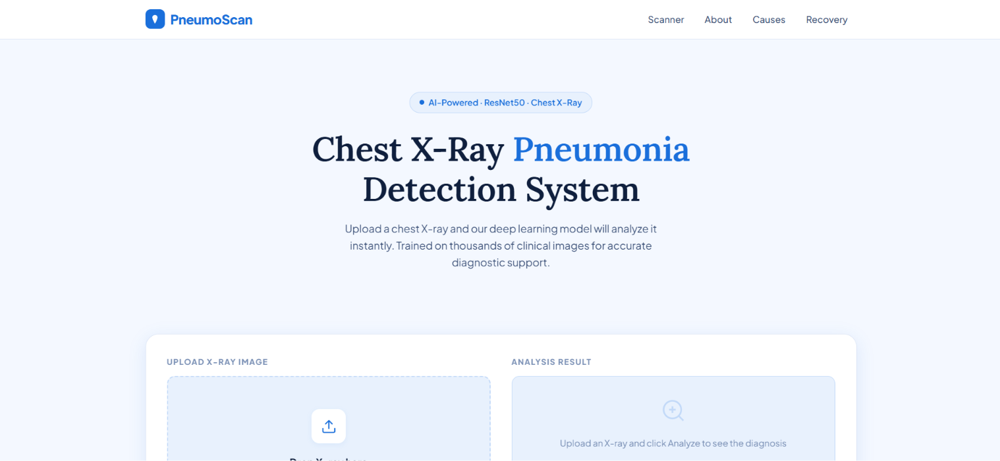

# PneumoScan - Chest X-Ray Pneumonia Classifier

A ResNet50 transfer-learning model that classifies chest X-rays as **NORMAL** or **PNEUMONIA**, with two ways to try it: a **FastAPI** web app and a **Streamlit** app.

> Research / educational prototype. Not a medical device and not for clinical use.



## Results (official test split, 624 images, threshold 0.5)

| Accuracy | Precision | Recall | AUC |
|---|---|---|---|
| 85.1% | 87.2% | 89.2% | 0.908 |

Notes and limitations:
- Dataset: [Chest X-Ray Images (Pneumonia)](https://www.kaggle.com/datasets/paultimothymooney/chest-xray-pneumonia) - 5,216 train (1,341 normal / 3,875 pneumonia), 16 validation, 624 test images.
- The training set is imbalanced, so class weights were used. The official validation set is tiny (16 images), so validation curves are noisy.
- The ResNet50 backbone is frozen (ImageNet weights); only the dense head is trained.
- Test performance is lower than training performance, which is expected with this dataset's distribution shift.

## Model

`ResNet50 (frozen, ImageNet) -> BatchNorm -> Dense 512 -> 256 -> 128 -> Dropout 0.5 -> Dense 1 (sigmoid)`

Preprocessing (must match training): resize to 224x224, rescale by 1/255, then per-image mean subtraction and std division.

## Project structure

```
notebooks/        training + evaluation notebook (Colab)
fastapi_app/      FastAPI backend + HTML page
streamlit_app/    Streamlit app
models/           put pneumonia_detection_model.keras here (see models/README.md)
```

## Run it

```bash
git clone https://github.com/<your-username>/pneumoscan-classifier.git
cd pneumoscan-classifier
pip install -r requirements.txt
# download the model into models/ first (see models/README.md)

# FastAPI (http://localhost:8000)
cd fastapi_app
uvicorn main:app --reload

# or Streamlit (from the repo root)
streamlit run streamlit_app/app.py
```

## Acknowledgements

Thanks to Dr. Mohamed Zorkany for supervision and guidance.
